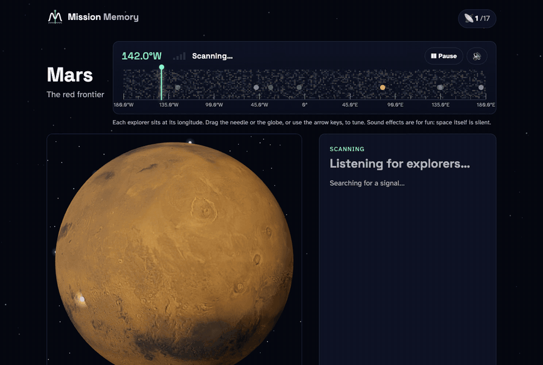
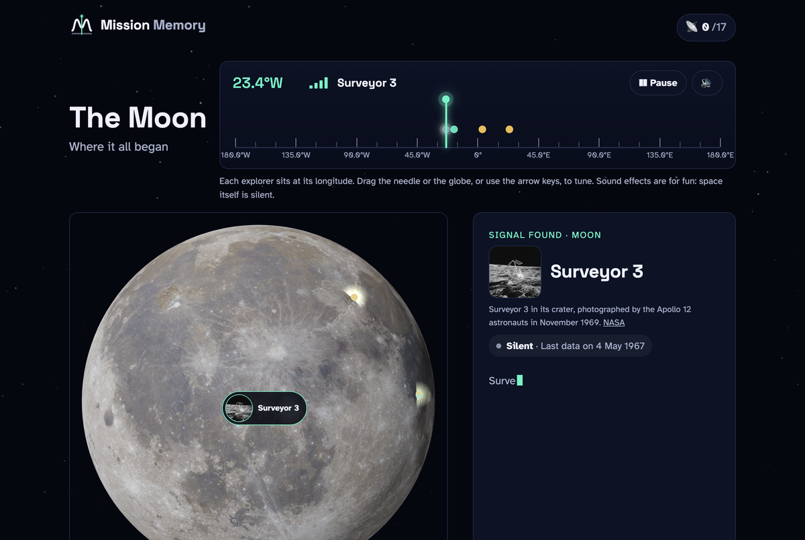
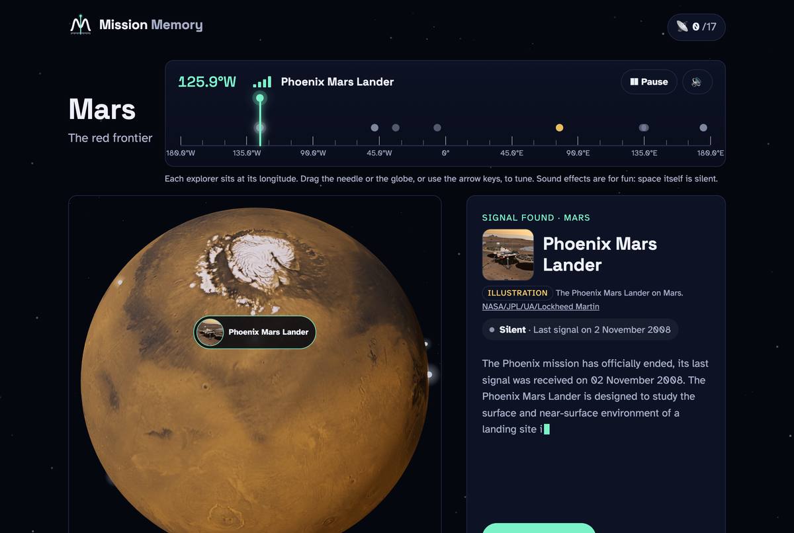
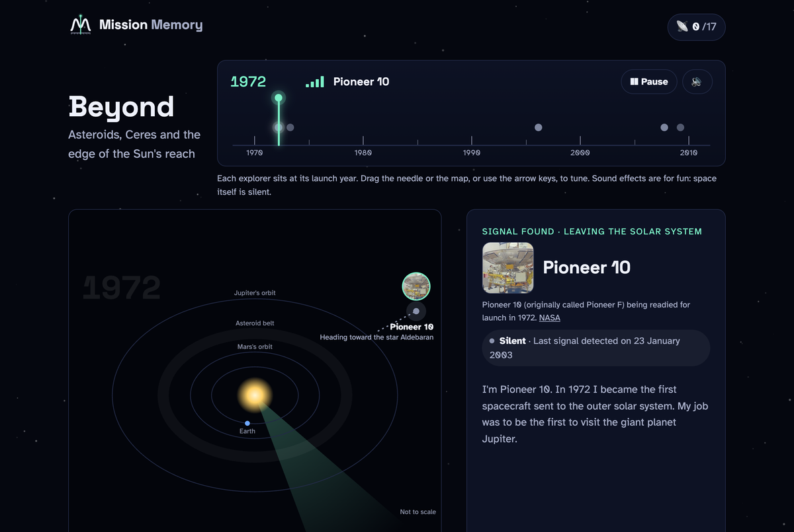
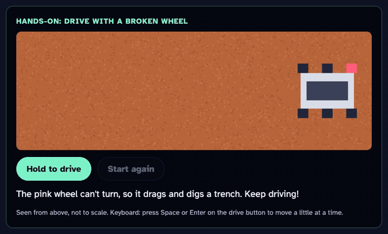
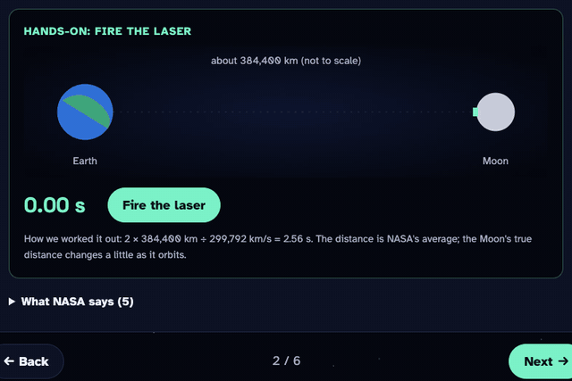
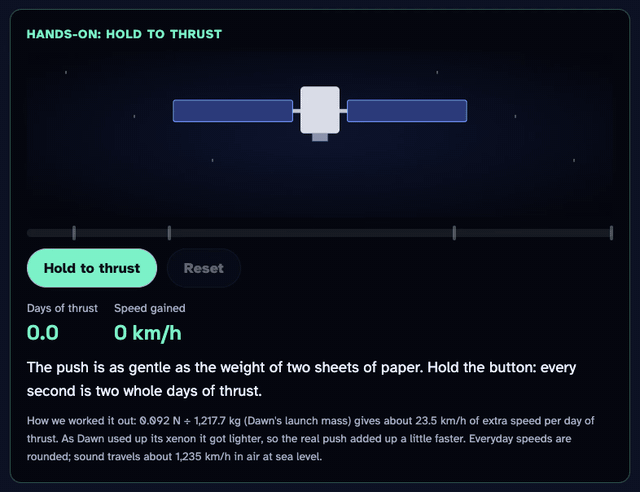
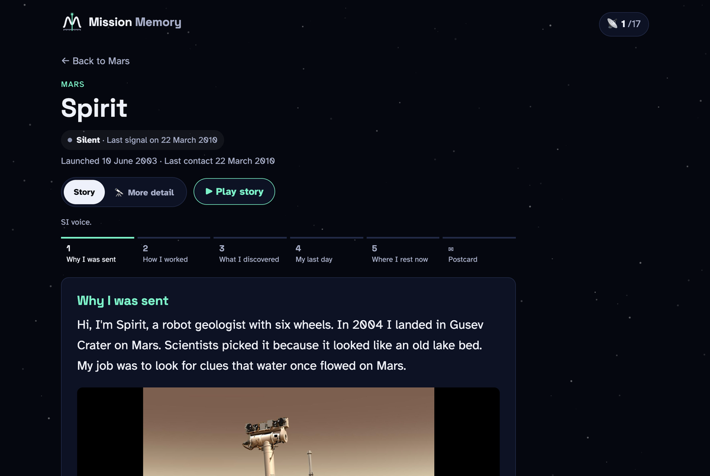
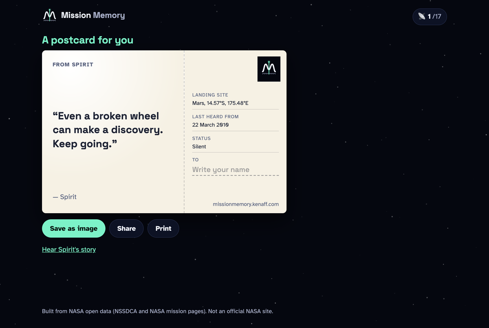
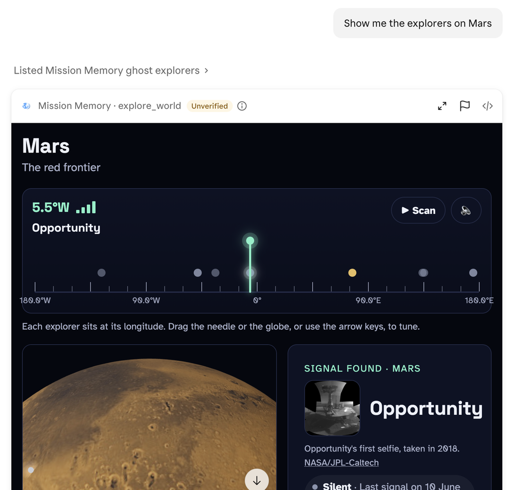

# Mission Memory

**Tune in to the explorers NASA left behind.**

Mission Memory is a narrated, interactive story experience for learners aged 9–14 about the NASA hardware resting on
the Moon, on Mars and beyond. Every retired rover, lander and probe appears as a "ghost" at its real NASA
coordinates. Tune in, and it tells its own story: why it was sent, how it worked, what it discovered, its last day,
and where it rests now. Every fact is traced to NASA's NSSDCA catalog or a NASA mission page.

Built for the [2026 NASA Space Apps Challenge](https://www.spaceappschallenge.org/2026/challenges/nasas-discarded-equipment-storytelling/):
*Abandoned but not Forgotten: Storytelling about NASA's Discarded Equipment on the Moon and Mars*.

- **Live:** https://missionmemory.kenaff.com
- **MCP server (for AI assistants):** `https://missionmemory.kenaff.com/mcp`

## See it in action

### Tune In

Turn the dial (or drag the globe) across a world. Static clears when you reach an explorer, and it starts to speak.



| Moon | Mars | Beyond |
|---|---|---|
|  |  |  |

### Hands-on moments

| Drive Spirit with a broken wheel | Bounce a laser off the Moon | Feel Dawn's gentle ion thrust |
|---|---|---|
|  |  |  |

### Stories and postcards

| Spirit tells its own story | A postcard to keep |
|---|---|
|  |  |

### Inside AI assistants

Add `https://missionmemory.kenaff.com/mcp` as a connector, then ask *"Show me the explorers on Mars"* or *"Tune in to Spirit"*.



## How it works

```text
https://missionmemory.kenaff.com   (one origin)
├── /                 web app (React + three.js), served by nginx
├── /embed/:id        story player without site navigation (framed by MCP hosts)
├── /data/*.json      reviewed, cited content
├── /media/*          NASA imagery and narration audio
└── /mcp              MCP server (Streamable HTTP), proxied to the private `mcp` container
```

- `web/` — Vite + React + TypeScript. Also builds `mcp-app.html`, the same player and world tuner bundled as an MCP Apps view.
- `mcp/` — Node + TypeScript MCP server. Tools: `list_ghosts`; `tune_in`, which opens an explorer's story player; and
  `explore_world`, which opens the Tune In dial and globe for the Moon, Mars or beyond (stories open inside the same view).
  Both views render as a `ui://` resource inside MCP clients. It reads its content from the `web` container, so both always match.
- `scripts/` — build-time data pipeline. `ingest.py` builds `artifacts.json` from NSSDCA and checks every quoted fact
  against its NASA page. `build_stories.py` does the same for every story beat in `stories.json`, then writes the
  fact-check checklist to `review/STORIES-REVIEW.md`. `images.py` fetches the chosen NASA Image and Video Library photos
  (`images.json`) with their official credits, and keeps the image table in `CREDITS.md` up to date. `narrate.py` voices
  approved stories with Kokoro TTS (voice `bm_fable`) into MP3s tagged as synthetic speech, re-voicing only chapters
  whose text changed.
- `brand/` — `build.py` regenerates the logo, favicons and link-preview image into `web/public`.

### Content pipeline

```bash
python3 scripts/ingest.py          # NSSDCA → artifacts.json (every quoted fact verified)
python3 scripts/images.py          # NASA Image Library photos + credits
python3 scripts/narrate.py         # narration for approved stories (needs: pip3 install kokoro soundfile; ffmpeg)
python3 scripts/build_stories.py   # verify story quotes, merge images + audio → stories.json, review checklist
```

## Run locally

```bash
# Production layout on http://localhost:8080
PUBLIC_ORIGIN=http://localhost:8080 docker compose -f docker-compose.yml -f docker-compose.local.yml up --build

# Web development with hot reload (http://localhost:5173)
cd web && npm install && npm run dev
```

For MCP work, use the Docker layout above. The MCP server reads the built `mcp-app.html` from the `web` container.

## Deploy (Dokploy)

1. Create a **Compose** service (type: Docker Compose) from this repository, with compose path `./docker-compose.yml`.
2. Under **Domains**, attach `missionmemory.kenaff.com` to service **`web`**, container port **80**, path `/`, HTTPS
   with Let's Encrypt. Don't give the `mcp` service a domain.
3. Deploy. `PUBLIC_ORIGIN` defaults to `https://missionmemory.kenaff.com`.

## Data, credits and SI use

See [CREDITS.md](CREDITS.md) for every data source, library, font and SI tool, and how each SI tool was used.

## License

[MIT](LICENSE)
